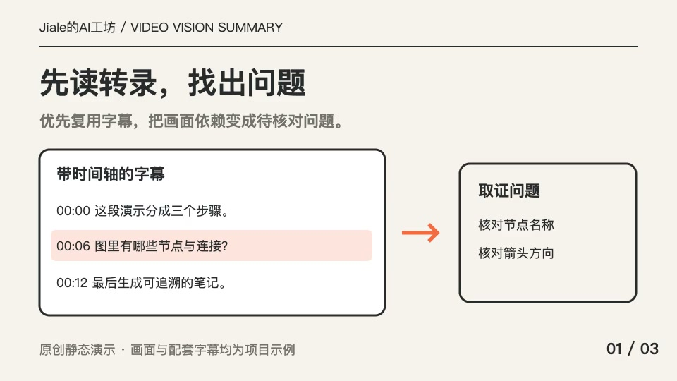
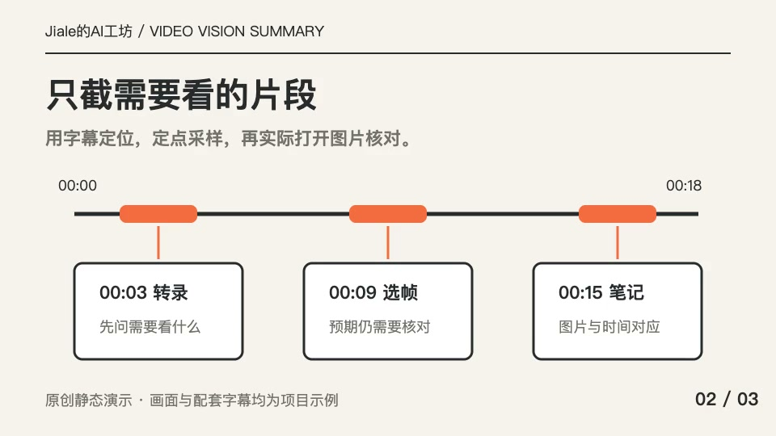
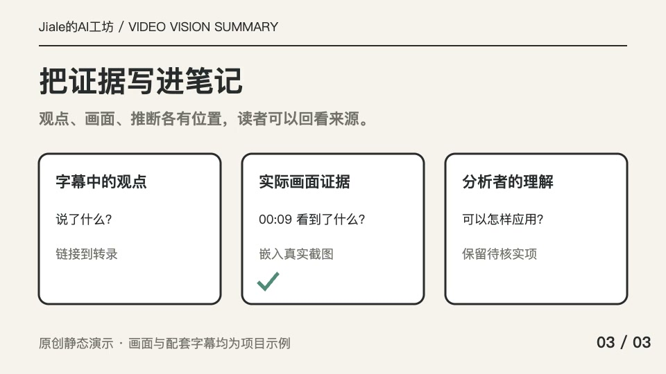
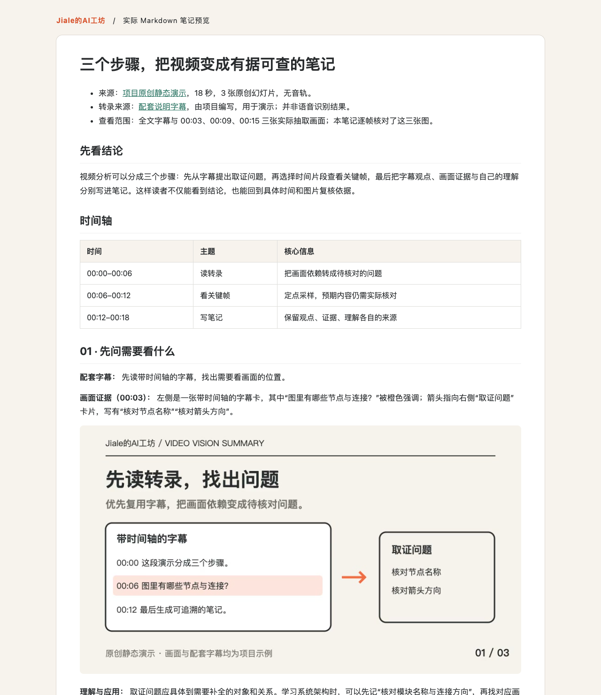

# Video Vision Summary · 视频分析技能

**把视频变成有时间戳、有画面证据、可以回看的 Markdown 笔记。**

面向学习技术课程、梳理产品演示、阅读讲座与代码讲解的人。先读转录，再挑需要看画面的片段，逐帧核对，最后写成笔记。可安装到 Codex、Claude Code，也能让支持本地文件与图片查看的 AI 助手按流程使用。


> 封面是主题插画。下方示例来自仓库自带的原创视频，展示实际生成的截图与笔记。

[看实际效果](#实际效果) · [安装技能](#安装技能) · [跑通第一个例子](#跑通第一个例子) · [完整教程](docs/getting-started.md)

## 能做什么

| 你手上有什么 | 怎么处理 | 最后得到什么 |
| --- | --- | --- |
| 本地视频＋字幕 | 复用 VTT / SRT / TXT / MD / JSON，规划选段 | 转录、取证问题、关键帧与结构化笔记 |
| 没有字幕的视频 | 可选本地 whisper.cpp 转写 | 带时间轴的转录，再进入画面分析 |
| 在线视频链接 | 通过 yt-dlp 下载视频，优先使用平台字幕 | 同一套可回溯的分析材料 |
| 以口播为主的视频 | 直接围绕转录分析，或仅选少量画面 | 明确分析范围的文字笔记 |

重点是补上**字幕里没有说清楚的画面信息**：图里的连接方向、PPT 的要点、代码片段、操作步骤。笔记区分字幕观点、实际画面和分析者推断，保留看不清、听不清及未覆盖的内容。

**脚本生成分析材料；AI 助手负责阅读、看图和撰写。** 项目自身不调用大模型 API。使用已有视频与字幕时无需额外转录密钥；AI 助手仍需具备运行脚本和查看图片的能力，并使用你已有的模型服务。

## 实际效果

仓库带有一个 **18 秒原创静态演示视频**、配套字幕和完整分析结果。视频无音轨，字幕是专门编写的说明，适合直接验证准备材料、抽帧与笔记流程。

| 00:03 · 读转录 | 00:09 · 看关键帧 | 00:15 · 写笔记 |
| --- | --- | --- |
|  |  |  |



笔记预览由实际 [note.md](examples/demo/result/note.md) 排版生成，展示成品内容；具体显示样式取决于你的 Markdown 阅读器。

直接查看：[示例笔记](examples/demo/result/note.md) · [选段 JSON](examples/demo/segments.json) · [帧索引](examples/demo/result/frames.json) · [演示视频](examples/demo/demo.mp4)

## 安装技能

需要 **Python 3.10+、FFmpeg**。在线下载另需 yt-dlp；本地 ASR 另需 whisper.cpp 与模型。纯本地视频＋字幕流程只使用 Python 标准库和 FFmpeg。

```sh
git clone https://github.com/Jiale077/video-vision-summary.git
cd video-vision-summary
python3 scripts/video_pack.py doctor
```

按你使用的助手，选择一条安装命令：

```sh
# Codex：安装到个人技能目录
python3 scripts/install_skill.py --skills-dir ~/.agents/skills

# Claude Code：安装到个人技能目录
python3 scripts/install_skill.py --skills-dir ~/.claude/skills
```

安装器只复制技能说明、脚本、参考资料与许可证。同名技能已存在时停止，保留原安装；需要升级时先自行备份。安装后按宿主要求刷新技能或开启新会话。也可以先在仓库目录跑下面的例子，再决定是否安装。

安装位置参考 [Codex 官方说明](https://learn.chatgpt.com/docs/build-skills#where-codex-loads-local-skills) 与 [Claude Code 官方说明](https://code.claude.com/docs/en/skills#choose-where-skills-load)。依赖安装与常见问题见 [教程](docs/getting-started.md)。

## 跑通第一个例子

在仓库根目录执行以下两步，不需要下载外部视频或配置转录服务。输出目录必须是新目录。

**1. 准备视频与字幕。**

```sh
python3 scripts/video_pack.py prepare \
  --video examples/demo/demo.mp4 \
  --transcript examples/demo/captions.vtt \
  --title "三个步骤，把视频变成笔记" \
  --output runs/my-first-video
```

实际分析时，先让 AI 阅读生成的 `plan.prompt.md` 与 `transcript.md`，再编写 `segments.json`。第一次体验可直接使用仓库预选好的三段：

**2. 按选段提取画面。**

```sh
python3 scripts/video_pack.py frames \
  --pack runs/my-first-video \
  --segments examples/demo/segments.json \
  --per-segment 1
```

**3. 把下面这句话发给 AI 助手。** 将材料包位置替换成你机器上的实际完整路径：

```text
请使用 video-vision-summary，读取 /你的完整路径/runs/my-first-video/analyze.prompt.md，
逐一打开其中的截图，结合转录写成同目录的 note.md。
分清字幕观点、画面证据和你的推断，并注明实际查看了哪些帧。
```

看到三张 JPG、`frames.json` 和 `analyze.prompt.md`，说明材料准备成功；AI 实际看图并写出 `note.md` 后，才完成分析。仓库已有 [完整示例笔记](examples/demo/result/note.md) 可对照。

日常使用时，也可以直接告诉已安装技能的助手：

```text
请分析这个视频：/path/to/video.mp4。
使用 /path/to/subtitles.vtt，先规划需要看画面的片段，再核对截图。
把结构化笔记和图片保存到 /path/to/new-output，重点解释图表和操作步骤。
```

## 结果放在哪里

```text
my-first-video/
├── manifest.json        # 来源、时长与真实转录后端
├── transcript.md        # 供人阅读的转录
├── transcript.json      # 规范化字幕与时间轴
├── plan.prompt.md       # 第一轮：读转录、规划选段
├── segments.json        # 选择的时间范围与取证理由
├── frames/              # 实际采样图片
├── frames.json          # 采样时间与图片对应关系
├── analyze.prompt.md    # 第二轮：逐帧核对与笔记要求
└── note.md              # 由 AI 助手撰写
```

`frames.json` 的 `vision_status: not_reviewed` 是材料生成状态，表示脚本尚未进行视觉分析；最终查看情况写在笔记证据索引中。脚本不会把提取图片等同于“已经看懂”。

## 进阶与边界

- [完整教程](docs/getting-started.md)：在线链接、本地转写、选段参数、常见报错。
- [笔记模板](references/note-template.md)：时间轴、画面证据与待核实项。
- [验证记录](docs/validation.md)：自动检查、真实媒体流程与未验证范围。

在线支持以 yt-dlp 对站点的实际可用性为准，YouTube / Bilibili 等站点的登录、网络或字幕情况可能变化。默认不读取浏览器登录状态；需要登录时可显式提供 cookies 文件，或使用已经取得的本地视频。项目不捆绑第三方视频、模型、浏览器会话或云账号。

抽帧适合静态幻灯片、图表、代码与操作节点。快速动画、连续动作或精确事件时序需要更多帧或实际播放复核。没有图像查看能力时，交付文字分析并说明缺口。云端转录可先导出字幕再导入，此版不内置云上传适配器。

## 开发与开源

```sh
python3 -m unittest discover -s tests -v
```

CI 在 Linux / macOS 上运行单元检查和 FFmpeg 实际媒体集成测试。欢迎通过 [Issue](https://github.com/Jiale077/video-vision-summary/issues) 反馈失败输入的格式与日志摘要，分享样例前移除私人素材和会话信息。

[MIT License](LICENSE)。独立重写的公开版本来自作者日常使用的视频学习流程；示例幻灯片与字幕为本项目原创，封面为 AI 生成主题插画。FFmpeg、yt-dlp 和 whisper.cpp 为独立安装的外部工具，沿用各自许可证，来源见 [资料与依赖](docs/sources.md)。

*Transcript first. Inspect selected frames. Write notes with evidence. A portable skill for vision-capable coding assistants.*
