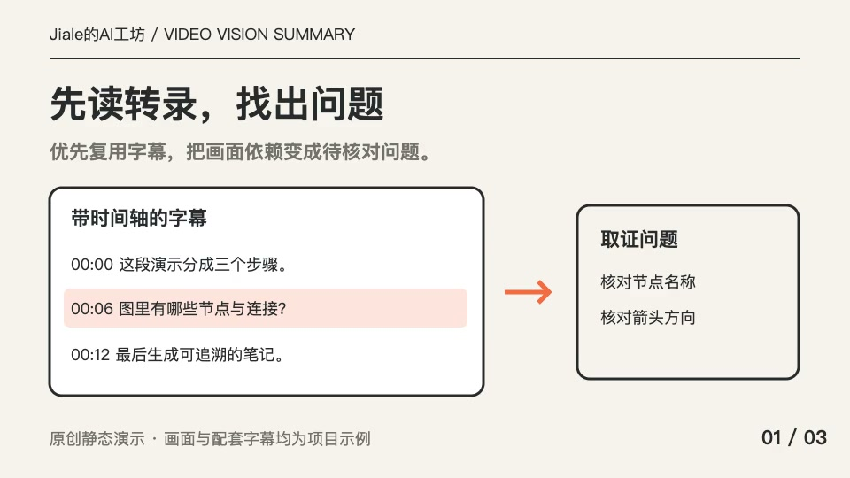
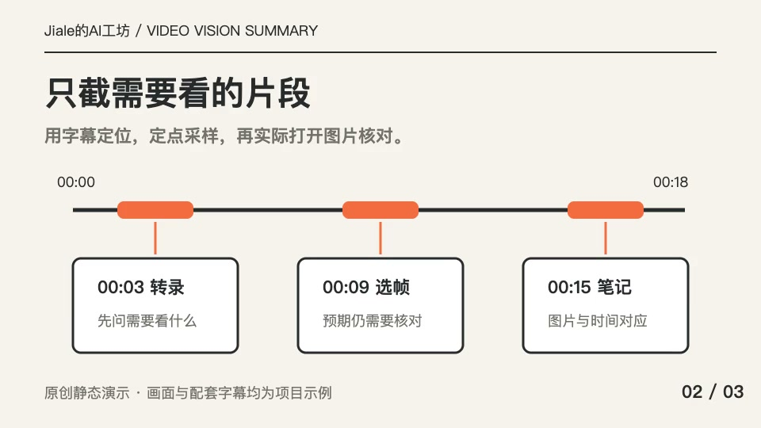
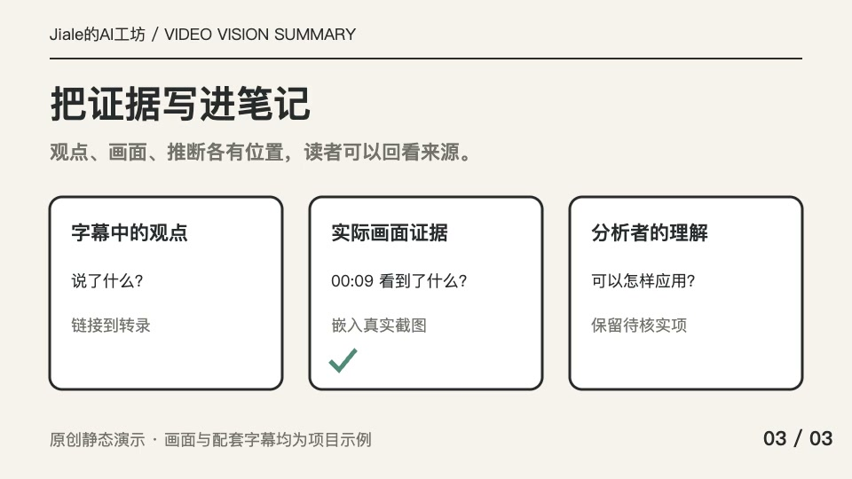

# 三个步骤，把视频变成有据可查的笔记

- 来源：[项目原创静态演示](../demo.mp4)，18 秒，3 张原创幻灯片，无音轨。
- 转录来源：[配套说明字幕](../captions.vtt)，由项目编写，用于演示；并非语音识别结果。
- 查看范围：全文字幕与 00:03、00:09、00:15 三张实际抽取画面；本笔记逐帧核对了这三张图。

## 先看结论

视频分析可以分成三个步骤：先从字幕提出取证问题，再选择时间片段查看关键帧，最后把字幕观点、画面证据与自己的理解分别写进笔记。这样读者不仅能看到结论，也能回到具体时间和图片复核依据。

## 时间轴

| 时间 | 主题 | 核心信息 |
| --- | --- | --- |
| 00:00–00:06 | 读转录 | 把画面依赖转成待核对的问题 |
| 00:06–00:12 | 看关键帧 | 定点采样，预期内容仍需实际核对 |
| 00:12–00:18 | 写笔记 | 保留观点、证据、理解各自的来源 |

## 01 · 先问需要看什么

**配套字幕：** 先读带时间轴的字幕，找出需要看画面的位置。

**画面证据（00:03）：** 左侧是一张带时间轴的字幕卡，其中“图里有哪些节点与连接？”被橙色强调；箭头指向右侧“取证问题”卡片，写有“核对节点名称”“核对箭头方向”。

**理解与应用：** 取证问题应具体到需要补全的对象和关系。学习系统架构时，可以先记“核对模块名称与连接方向”，再找对应画面。这里的架构应用是分析者的延伸例子。

## 02 · 用时间轴定位图片

**配套字幕：** 示例在 3 秒、9 秒和 15 秒分别查看三个步骤。

**画面证据（00:09）：** 上方时间轴从 00:00 到 00:18，橙色标记连接到三张卡片，分别是“00:03 转录”“00:09 选帧”“00:15 笔记”。卡片说明包含“预期仍需要核对”。

**理解与应用：** 抽到图片只是拿到了材料。仍需要打开图片，确认预期内容是否存在、文字是否可读。长视频可先挑少量信息密集片段；本 18 秒演示为呈现全部步骤，选段覆盖比例高于长视频的常用建议。

## 03 · 把观点、证据和推断分开

**配套字幕：** 三种信息分别表达，合成带来源与时间戳的笔记。

**画面证据（00:15）：** 画面并列三列：“字幕中的观点”“实际画面证据”“分析者的理解”。下方分别要求链接到转录、嵌入真实截图、保留待核实项。中间列用青绿色勾提示实际核对。

**理解与应用：** 笔记既可以总结内容，也应保留结论的依据。举例和应用可以帮助理解，但要能与原视频表达区分。

## 待核实与未覆盖

本演示没有音轨，因此没有验证字幕与语音的一致性，也没有检验 ASR 准确度。三张定点画面已查看；它们不能代表其他视频中所有转场、动画和连续操作状态。

## 证据索引

- [完整转录](transcript.md)
- [选段与取证理由](segments.json)
- [实际采样索引](frames.json)：3 张，采样时间为请求位置，对应附近解码帧。
